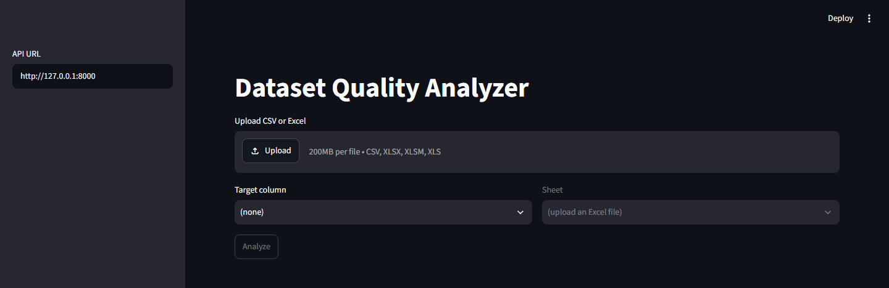
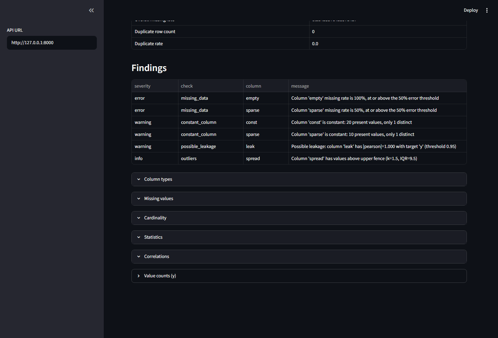
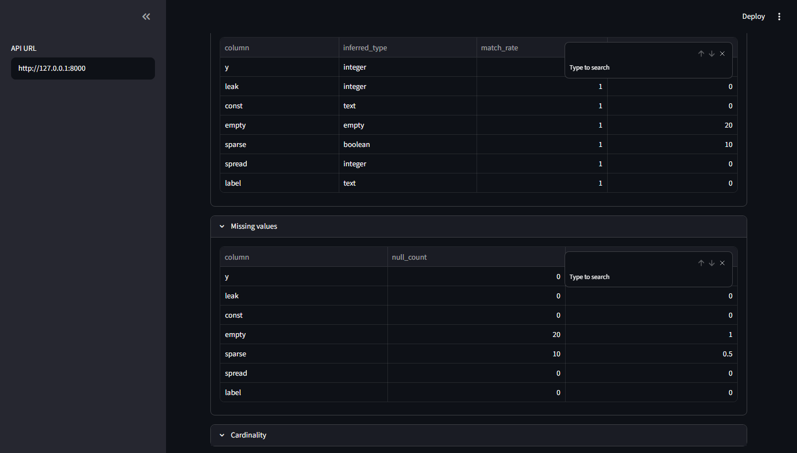

# Dataset Quality Analyzer

A tool that checks how good a dataset actually is before you use it for analysis or machine learning.

You give it a CSV or Excel file. It loads the data, profiles it (shape, column types, missing values, duplicates, cardinality, basic statistics, correlations), then runs quality checks on top of that (missing-data issues, constant columns, class imbalance, outliers, possible data leakage). All of it comes together as a single quality report.

**Status:** library, HTTP API, and Streamlit UI are in place.

## What it does

- Load CSV or Excel (every column as text; optional `filename=` for nameless upload streams)
- Profile shape, types, missing values, duplicates, cardinality, statistics, correlations, and target value counts
- Check missing data, constant columns, outliers, class imbalance, and possible leakage
- Return one JSON report from `analyze_file` / `POST /analyze`
- Streamlit uploads a file, calls the API, and shows severity counts, findings, and the profile tables

## Project layout

| Path | What lives there |
| --- | --- |
| `dqa/` | Core library. No framework code. |
| `api/` | FastAPI: `GET /health`, `POST /analyze` |
| `ui/` | Streamlit app plus the HTTP client it uses |
| `tests/` | Tests for the library, API, and UI helpers |
| `data/` | Sample datasets used while developing |

## Setup

```powershell
python -m venv venv
.\venv\Scripts\Activate.ps1   # Windows
pip install -e ".[api,ui,dev]"
```

## Running tests

```powershell
python -m pytest
```

## Usage

```python
from dqa import load_dataset

result = load_dataset("data/samples/people.csv")

result.dataframe        # the pandas DataFrame
result.row_count        # 2
result.column_count     # 3
result.file_format      # "csv"
result.sheet_name       # None for CSV, the sheet name for Excel
result.available_sheets # None for CSV, every sheet name for Excel
```

For Excel files you can pick a sheet; the first one is used by default.

```python
result = load_dataset("data/samples/book.xlsx", sheet_name="sales")
```

Every column is read as text, so values like the zip code `02134` are not silently
turned into the number `2134`. Working out what a column really holds is the
profiler's job, not the loader's. Blank cells are still read as real nulls, so
missing-value counts stay accurate.

Loading problems are raised as the tool's own exceptions rather than pandas ones,
so nothing above the loader needs to know pandas is involved:

| Exception | When |
| --- | --- |
| `UnsupportedFileFormatError` | Not a CSV or Excel file |
| `EmptyDatasetError` | The file is empty, or has headers but no rows |
| `DatasetLoadError` | The file is missing, unreadable, corrupt, or the sheet does not exist |
| `ColumnNotFoundError` | `target` names a column that is not in the file |

All of these inherit from `DQAError`.

A full report, including findings, is `analyze_file`:

```python
from dqa import analyze_file

report = analyze_file("people.csv", target="label")
report.to_dict()
```

## API and UI

From the repo root, start the API, then the UI (the UI talks to the API over HTTP):

```powershell
.\venv\Scripts\python.exe -m uvicorn api.main:app --reload
.\venv\Scripts\python.exe -m streamlit run ui/app.py
```

`POST /analyze` takes the file plus optional form fields `target` and `sheet_name`. Domain errors map to 415 (unsupported format), 422 (unreadable or empty), and 400 (unknown target). The app copies at most 25 MB into memory for analysis; a production upload cap belongs in a reverse proxy in front of the process.

## Screenshots

Upload a CSV or Excel file, pick a target column if you have one, then run the analysis. The shots below use a small sample with missing values, a constant column, an outlier, and a column that copies the target.



Findings for that sample, including a possible-leakage warning.



Profile sections under that table show column types, missing values, and the other summaries.


